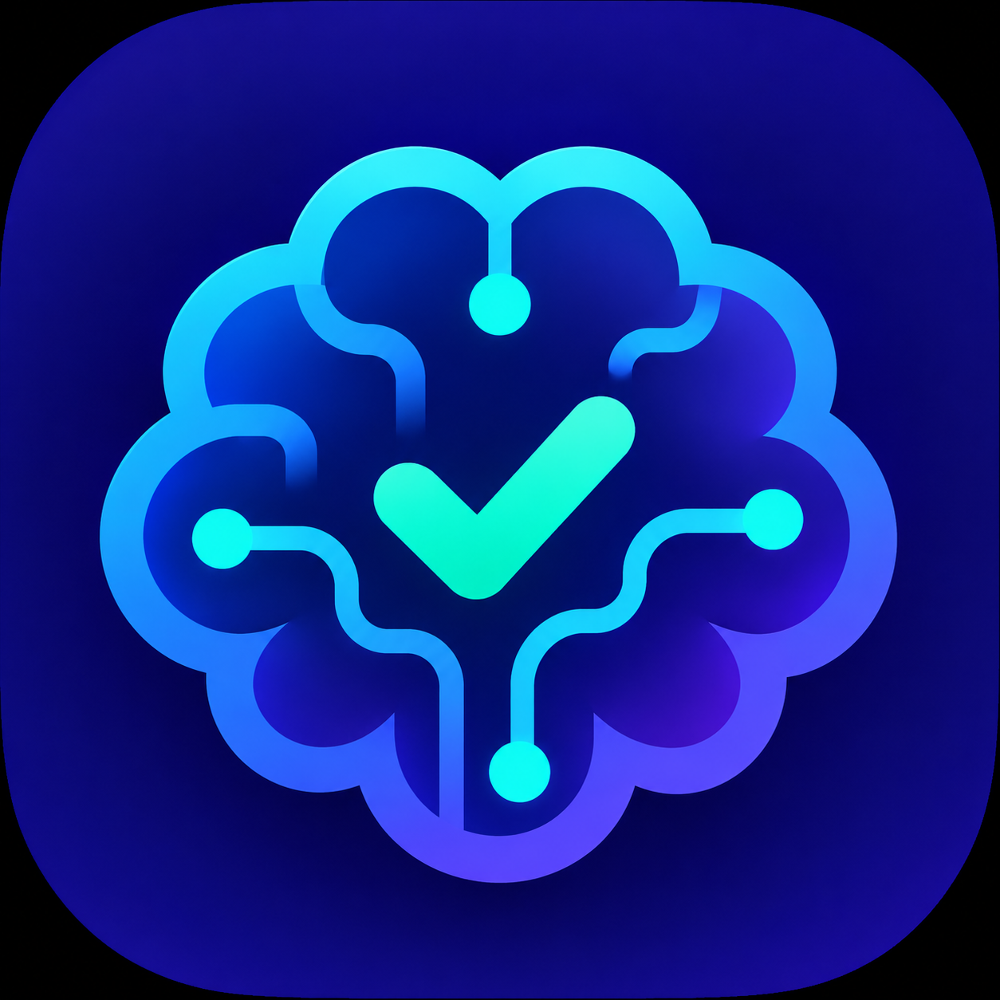

# mindKeeper AI



Планы и напоминания в Home Assistant, Telegram и Google Calendar — с пониманием
обычного текста через выбранный AI: Codex, Gemini, DeepSeek, Qwen и другие сервисы.

[](https://github.com/nyrouxx/mindkeeper-ai/actions/workflows/ci.yaml)
[](https://github.com/nyrouxx/mindkeeper-ai/releases)
[](LICENSE)

Разговаривайте с существующим Telegram-ботом как с человеком:

> В пятницу в четыре приём у врача. Это важно.
>
> Перенеси его на понедельник.
>
> Я уже сходил, отметь.
>
> Что у меня на выходных?

Секретарь понимает контекст, сохраняет дела в Home Assistant и сам определяет
категорию и важность. Отвечает обычным языком. Если непонятно, какое дело или какой
день имеется в виду, задаёт уточняющий вопрос.

**Версия 0.7.0.** По умолчанию используется существующий вход в ChatGPT через Codex.
Другого AI можно выбрать в настройках: облачный API с собственным ключом или локальная
модель через Ollama. Голос и контроль счетов ЖКХ пока не подключены.


## Выбор AI

В панели **mindKeeper AI → ⚙ → Настроить AI** либо в **Устройства и службы → mindKeeper AI → Настроить → AI** выберите провайдера и модель. Изменение применяется без перезапуска HA. Дела, черновики, напоминания и связи Google Calendar сохраняются.

| Вариант | Подключение | Условия доступа |
| --- | --- | --- |
| Codex / ChatGPT | Существующий вход ChatGPT и приватный Codex runtime | Лимиты аккаунта ChatGPT; API-ключ не нужен |
| Gemini | Ключ Google AI Studio | Для некоторых моделей доступна бесплатная квота, с ограничениями по региону и аккаунту |
| DeepSeek | Ключ DeepSeek API | Облачный API оплачивается отдельно от чата на сайте |
| Qwen | Ключ Alibaba Cloud Model Studio и адрес API своего региона/workspace | Для новых аккаунтов возможна пробная квота на 90 дней; режим **Free Quota Only** включается в кабинете Alibaba |
| Яндекс | Ключ AI Studio, ID каталога и модель | Отдельный облачный тариф; это не пользовательская сессия Алисы |
| OpenAI API | Ключ OpenAI API | Тариф и доступные кредиты API проверяются в кабинете OpenAI |
| Ollama | Адрес уже запущенного сервера и имя загруженной модели | Для локальной модели нет платы за облачные запросы; нужен собственный компьютер/сервер |
| Другой API | Базовый URL, модель, при необходимости ключ | Chat Completions API с JSON-ответами; например LM Studio |

Ключ вводится один раз в поле пароля и сохраняется в отдельном приватном хранилище
`.storage/personal_secretary.<entry_id>.ai`, а не в options интеграции. Сохранённый ключ
не возвращается в браузер, статусы или логи. Пустое поле сохраняет ключ; флажок удаления
убирает его, после чего для этого сервиса потребуется новый ключ. Настройки разных
провайдеров запоминаются отдельно.

**Проверить подключение** проверяет текущие поля формы без их сохранения и отправляет
только тестовую фразу, без списка ваших дел. Для активации нажмите **Сохранить AI**.
При обработке сообщений выбранный сервис получает текст, ограниченную историю диалога
и контекст дел. При отказе, исчерпании квоты или неполном JSON исходное сообщение
остаётся в очереди; операции не применяются частично. Автоматического платного
fallback на другой сервис нет.

Для API-провайдеров установка Codex и вход ChatGPT не нужны. У Codex сохранены прежние
ограничения инструментов и изолированный runtime. Встроенные HTTP-клиенты не дают
модели инструментов HA, доступа к файлам или платежам; ответ проверяется локально.

Ollama нужно настроить отдельно: интеграция не устанавливает сервер и не скачивает
модели. Пример адреса — `http://192.168.1.10:11434/v1`, модели — `qwen3:8b`. Адрес
`localhost` означает сервер Home Assistant, а не компьютер с открытым браузером.
Для Qwen берите актуальный адрес API из кабинета Alibaba; ключ и адрес должны относиться
к одному региону/workspace. Названия моделей можно менять вручную, не обновляя интеграцию.

Условия и лимиты проверяйте у провайдеров: [Gemini](https://aistudio.google.com/docs/pricing),
[DeepSeek](https://api-docs.deepseek.com/quick_start/pricing/),
[Qwen](https://www.alibabacloud.com/help/en/model-studio/new-free-quota),
[Яндекс](https://aistudio.yandex.ru/en/docs/ai-studio/operations/generation/completions-structured),
[OpenAI](https://developers.openai.com/api/docs/models/gpt-6-luna),
[Ollama](https://docs.ollama.com/api/openai-compatibility). Условия проверены 11 ноября 2026 года.

<!-- ha-marketplace:exclude-start -->
## Установка через Marketplace / HACS

[](https://my.home-assistant.io/redirect/hacs_repository/?owner=nyrouxx&repository=mindkeeper-ai&category=integration)

1. В Home Assistant откройте **Настройки → Marketplace → Добавить по ссылке**.
2. Укажите `https://github.com/nyrouxx/mindkeeper-ai` и тип **Интеграция**, если он запрошен.
3. Откройте mindKeeper AI и установите релиз. При необходимости подключите GitHub в Marketplace.
4. Перезапустите Core и добавьте **mindKeeper AI**
   в **Настройки → Устройства и службы → Добавить интеграцию**. Выберите Telegram-бота и чат.

Для HACS используется тот же репозиторий с типом Integration. Минимальная проверенная
версия Home Assistant — **2026.11.1**. [Документация Marketplace](https://www.home-assistant.io/integrations/marketplace/#custom-repositories).

### Переход с локальной установки

Сначала сделайте резервную копию конфигурации HA. Установите пакет Marketplace
поверх прежнего `custom_components/personal_secretary` и перезапустите Core.
**Существующую запись интеграции в «Устройства и службы» удалять не нужно.**
Домен `personal_secretary`, unique IDs, `.storage/personal_secretary.*` и приватный
каталог `.personal_secretary` сохранены: дела, Google-связи, чат и вход ChatGPT останутся.
Будущие версии устанавливайте через Marketplace, без повторного запуска локального
установщика исходников.
<!-- ha-marketplace:exclude-end -->

## Перед первой настройкой

Нужна настроенная штатная интеграция **Telegram Bot** с разрешённым чатом.
Для понимания текста выберите один AI-провайдер. Для варианта Codex дополнительно
нужны **Codex CLI** в Linux-окружении Core и аккаунт с доступом к Codex.
API-варианты используют ключ выбранного сервиса, локальный Ollama — адрес сервера
и модель. Google Calendar необязателен, подключается штатной интеграцией HA.

**Пакет Marketplace не содержит исполняемый файл Codex и вашу авторизацию.**
Если выбираете Codex и runtime ещё не подготовлен, используйте инструкцию ниже.
При выборе API или Ollama этот шаг не нужен. Планировщик, календарь и ручное
редактирование работают локально; выбранный AI нужен для разбора новых сообщений.

## Напоминания

Одно обычное напоминание **за час до начала**. Перезапуск и изменение меток его
не меняют, перенос пересчитывает. Если до начала меньше часа, напоминание придёт
сразу. После простоя обычные уведомления о прошедших событиях не рассылаются.

«Надо заехать в магазин» без даты и времени означает **сегодня, в течение дня**.
«Завтра заехать в магазин» — весь завтрашний день. Это настоящая дата без времени:
дело видно в календаре HA/Google, списке и сообщении «Дела на сегодня».
В форме можно выбрать день и оставить «В течение дня» либо указать точное время.
Только явное «когда-нибудь», «без срока» оставляет дело совсем без даты.

Первое напоминание о деле на день настраивается: через час после добавления сегодня
(по умолчанию) или в заданное время дня. Для будущих дней используется заданное
время, по умолчанию 09:00 в часовом поясе HA. Если оно сегодня уже прошло — сразу.

Для отдельных задач можно включить **«🔁 Напоминать до ответа»** — метку в карточке
дела. По умолчанию выключена и не зависит от важности. Первый раз секретарь напомнит
за час до начала (для дела без времени — по выбранной настройке), затем повторяет
каждые 10 минут до ответа. Интервал отсчитывается **после первого уведомления**. Он меняется
в настройках, от 1 до 180 минут. В этом режиме повторы продолжаются и после времени
события, пока дело активно и не получен ответ.

Ответьте на конкретное напоминание. Прямой текстовый ответ **завершает дело** и
останавливает повторы сразу, до обращения к модели. «Вижу», «помню», «ок» и «сделал»
обрабатываются локально, без обращения к модели. Если ожидалось подтверждение единственного дела,
короткое «вижу» без привязки тоже подходит; при нескольких делах нужно указать,
какое имеется в виду. Отключение метки, завершение или отмена также останавливает
повторы. Если в ответе была просьба перенести или продолжить дело, секретарь
переоткроет его и установит новую дату; цикл напоминаний начнётся заново.

## Автоматическое завершение

Обычные дела без метки «Напоминать до ответа» автоматически завершаются **после
окончания события**. Если конец не указан, длительность — 30 минут: дело на 16:00
закроется в 16:30. Дело без точного времени завершается в конце выбранного дня,
в полночь по часовому поясу HA; многодневное — в конце последнего дня. Дело совсем
без даты автоматически не закрывается.

Метка «Напоминать до ответа» отключает завершение по времени: дело остаётся активным
и после окончания события, пока пользователь не ответит на напоминание, не завершит
или не отменит его. Сообщения других пользователей и ответы на посторонние сообщения
задачи не завершают. При нескольких ожидающих делах ответ должен быть привязан к
конкретному напоминанию или явно называть дело.

Планировщик проверяет сроки каждые 30 секунд, работает без модели и догоняет
пропущенные завершения после перезапуска. Сохраняются история, дата и причина
завершения; в панели есть метка «Завершено по времени». Запись в Google остаётся
на прежнем месте с отметкой ✅. Если автоматически закрытое событие перенести
в Google на будущее, дело откроется заново, отметка выполнения снимется.

Уже прошедшие обычные дела также завершаются после установки этой версии.

Режим можно включить словами: «Напоминай про заказ, пока я не отвечу».
Регулярных новых сводок и рассылок по умолчанию нет. Картинки, подписи к ним и другие
вложения игнорируются молча: не передаются модели, не создают задачи и не подтверждают
напоминания. Общение остаётся текстовым, без команд и кнопок Telegram.

## Одно сообщение «Дела на сегодня»

При включении интеграция отправляет в выбранный Telegram-чат одно HTML-сообщение:
заголовок, дата, дела на текущий день по времени, звёздочки важных и отметки выполнения.
Завершённые дела зачёркнуты. Закрепите это сообщение вручную. Бот сохраняет его номер
и **редактирует то же сообщение**, когда меняются дела или наступает следующий день
по часовому поясу HA. Новое сообщение каждое утро не создаётся, закрепление сохраняется.
Модель для этого не вызывается.

Если весь список не помещается в лимит Telegram, сообщение показывает, сколько ещё
дел доступно в панели. Для каждого бота и чата сохраняется своя ссылка на сообщение;
возврат к прежнему чату использует прежнее сообщение. Если оно удалено, бот создаст
замену — её нужно закрепить заново.

В настройках есть переключатель этого сообщения и кнопка обновления. При
неподтверждённой первоначальной отправке кнопка позволяет явно создать сообщение
снова. После отключения существующее сообщение не удаляется, его обновления прекращаются.

## Панель mindKeeper AI

Отдельный пункт в боковом меню Home Assistant:

- месячный календарь с событиями по дням и времени;
- список дел, в том числе без даты;
- фильтры по категории и важности;
- просмотр и редактирование дела, даты, подробностей и меток;
- отметка о выполнении и возврат в планы;
- отдельная метка «Напоминать до ответа» и отображение подтверждения;
- добавление дела свободным текстом или через форму.

Календарь и список обновляются при изменениях, без перезагрузки страницы. Часовой
пояс берётся из HA. Те же дела доступны в штатных сущностях календаря и списка дел.
Панель и её WebSocket API доступны администраторам HA.

Настройки меток открываются шестерёнкой в панели либо через
**Настройки → Устройства и службы → mindKeeper AI → Настроить**.

Там же настраиваются сообщение на сегодня и интервал повторов.

Начальные категории: **Повседнев, Отдых, Стройка, Здоровье, Работа**.
Начальные уровни важности: **Обычная, Важная**.
Можно добавлять свои названия и удалять ненужные. Первый уровень важности считается
обычным, остальные — повышенными. При удалении использованной метки секретарь
переклассифицирует соответствующие активные дела. Метки, выбранные вручную и
оставшиеся в настройках, сохраняются. Если добавить дело через UI без меток,
нейросеть подберёт их в фоне; само дело сохраняется сразу.

## Telegram: бот и собеседник

В панели откройте **шестерёнку → Telegram → Настроить**. То же доступно через
**Настройки → Устройства и службы → mindKeeper AI → Настроить → Telegram: бот и получатель**.

Выберите бота и разрешённый личный чат либо группу. В личном чате собеседник
определяется автоматически. Для группы укажите положительный Telegram ID
пользователя, чьи сообщения должен принимать секретарь. Другие участники не могут
менять планы. Бот должен иметь доступ к обычным сообщениям группы.

Список берётся из штатной интеграции **Telegram Bot**. Новые боты, токены и
разрешённые чаты добавляются там; из панели есть ссылка на её настройки. Секретарь
не хранит отдельную копию токена Telegram и не запускает второго получателя сообщений.
Изменение подключения через UI применяется сразу, без перезапуска HA; дела сохраняются.

Ответ на уже принятое сообщение остаётся в исходном чате, даже если подключение
изменено во время обработки. Будущие напоминания направляются в выбранный сейчас
чат. Идентификаторы сообщений и ответы сопоставляются в пределах конкретного бота
и чата, чтобы одинаковые номера сообщений разных ботов не смешивали задачи.

## Google Calendar

Подключите [штатную интеграцию Google Calendar](https://www.home-assistant.io/integrations/google/)
с правом изменения событий. Она проводит вход через Google и управляет токенами;
mindKeeper AI использует её авторизованный клиент и не хранит Google-пароли и токены.
Свой OAuth-клиент и протокол входа интеграция не реализует.

В панели mindKeeper AI откройте шестерёнку, выберите календарь и направление:

- **В обе стороны**: события выбранного календаря становятся делами, изменения
  названий, описаний и дат переносятся между HA и Google. При одновременной правке
  разных полей изменения объединяются. При конфликте одного поля приоритет у Google;
  число конфликтов показывается в настройках. Даты рассматриваются как единое поле.
- **Только дела → Google**: сторонние события не импортируются, для связанных
  событий значения дела в HA являются основными.
- **Выключено**: локальные дела и уже созданные Google-события сохраняются.

Настроить можно и через «Настройки → Устройства и службы → mindKeeper AI → Настроить
→ Google Calendar». Лучше создать отдельный Google-календарь для дел: в режиме
обмена в обе стороны все его обычные события будут импортироваться.

Обмен запускается после локальных изменений и раз в пять минут. В настройках есть
ручная синхронизация, время успешного обмена и сообщение об ошибке. Данные не
отменяются при недоступности Google. Связи задач и событий хранятся атомарно;
при потере ответа на создание повторный запуск использует тот же ID без дублей.

Связи принадлежат самому Google-календарю и сохраняются при удалении и повторном
подключении штатной интеграции Google, смене OAuth-клиента или имени сущности HA.
Версия 0.5.1 исправляет привязку к временному ID подключения, из-за которой 0.5.0
могла повторно импортировать собственные события после переподключения.
Старые связи восстанавливаются по сохранённым ID событий. Доказанные повторные
импорты архивируются с указанием исходного дела; история и метки исходных дел
сохраняются. Лишние созданные интеграцией события удаляются только после повторной
проверки совпадения с оригиналом. Перед удалением их данные сохраняются в приватном
хранилище. Задачи с отдельными правками и сторонние Google-события автоматически
не объединяются. Ошибка связи или несовпадение данных останавливает очистку, а её
состояние сохраняется для безопасного продолжения после перезапуска.

Выполнение дела помечает событие в Google знаком ✅, сохраняя историю. Отмена
удаляет только связанное событие; удаление события в Google отменяет дело в HA.
При снятии срока событие удаляется, а дело остаётся без даты. Категории, важность
и режим до ответа остаются настройками HA. Повторяющиеся Google-события импортируются
отдельными конкретными вхождениями; серия из Telegram пока не создаётся. У выполненного события можно убрать ✅ из
названия в Google, чтобы вернуть дело в активные.

Импортируются события от 30 дней назад до года вперёд. Уже связанные события
проверяются по ID и при переносе за эти границы. Переключение календаря сохраняет
прежние связи и события, в новый выбранный календарь передаются активные дела.
Учётные данные Google остаются в штатной интеграции; при её удалении обмен прекращается.

Адаптер рассчитан на интерфейс штатного Google Calendar в HA 2026.11.1. Его клиент
`gcal-sync` используется для обновлений, поскольку календарная сущность Google
предоставляет создание и удаление, а обновление не реализует. Результат каждого
изменения дополнительно читается с сервера перед сохранением состояния синхронизации.

## Как подключён ChatGPT

HA самостоятельно запускает официальный Codex CLI для разбора текста. Сохранённый
вход ChatGPT находится в приватном каталоге конфигурации HA; текущую терминальную
сессию Codex держать открытой не нужно. Пароль и API-ключ не передаются с сообщениями.
Расходуется доступ и лимит подключённого аккаунта ChatGPT/Codex. Повторный вход
доступен в настройках интеграции через код устройства.

Для этого способа нужен доступ к Codex CLI; актуальные условия описаны в
[OpenAI Docs](https://learn.chatgpt.com/docs/pricing). Возможности бесплатного
настольного приложения не гарантируют доступ к CLI для фоновой автоматизации.
При отсутствии доступа к модели календарь, ручное редактирование и сохранённые
напоминания продолжают работать локально; новые сообщения сохраняются для обработки.
Отдельное подключение через OpenAI API доступно в настройках AI. Оно использует
ключ API, не файл авторизации Codex.

## Подключение Codex (только для варианта Codex / ChatGPT)

Codex работает в Home Assistant Core отдельным процессом. Исполняемый файл
сохраняется в `<конфигурация HA>/.personal_secretary/bin/codex`, авторизация — в
`<конфигурация HA>/.personal_secretary/codex-home/auth.json`. Версия CLI должна
поддерживать `exec --output-schema` и device-code вход через `app-server`.

В окружении с Python 3 и уже установленным и авторизованным официальным Codex CLI
скачайте исходники этого репозитория и выполните:

```sh
python3 tools/install.py --runtime-only --reuse-login --ha-config /homeassistant --codex-home /config/codex
```

Пути — для Codex add-on с общей конфигурацией HA. В другом окружении укажите
свой каталог конфигурации HA и каталог авторизации Codex. Команда подготавливает
runtime и при его отсутствии копирует собственный кеш входа; существующие бинарник
и авторизация не перезаписываются. Файлы интеграции, установленные Marketplace,
не меняются. Не используйте эту команду с чужими учётными данными.

После установки пакета перезапустите Core и настройте интеграцию через UI.
Повторный вход доступен в **mindKeeper AI → Настроить → Войти заново в ChatGPT**:
откройте страницу OpenAI, введите код устройства и вернитесь в HA. Пароль и API-ключ
в HA вводить не нужно. Для device-code входа может потребоваться разрешить его
в настройках безопасности ChatGPT. См. [OpenAI Docs](https://learn.chatgpt.com/docs/auth#login-on-headless-devices).

Автоимпорт через YAML `personal_secretary: {}` оставлен для существующих установок.
Для новой установки достаточно UI. Голос, внешний агент и проверка оплаты ЖКХ
в этот релиз не входят. Исполняемый файл Codex (в проверенной установке около
306 МиБ) и личные данные в репозиторий и архив релиза не включаются.

## Сохранность

Задачи, история разговора, номера сообщений на сегодня и очереди находятся в приватном атомарном хранилище
`.storage/personal_secretary.<entry_id>`. Последние 200 обработанных сообщений
используются для контекста; необработанные не удаляются. Задачи сохраняются
независимо от памяти модели. Авторизация CLI находится в `.personal_secretary/codex-home`,
для локальной разработки исходники дополнительно могут сохраняться в `.personal_secretary/source.bundle`.
При обновлении с 0.4 прежние активные дела совсем без даты получают сегодняшний
день; уже отправленные и подтверждённые напоминания заново не запускаются.
Технический домен `personal_secretary`, ключи хранилища и идентификаторы сущностей
сохранены при переименовании, чтобы прежние дела и ссылки продолжили работать.
Эти каталоги входят в конфигурацию HA и должны включаться в защищённую резервную копию.

Сообщение сохраняется до вызова модели. Временные ошибки повторяются в фоне.
Планировщик работает локально и не обращается к модели для обычного напоминания.
После длительного простоя обычные напоминания о прошедших событиях не рассылаются.
Для задач с явно включённым режимом до ответа повтор продолжается до подтверждения.
Telegram не гарантирует идемпотентную доставку: при сбое сети сообщение может
повториться; при перезапуске посреди отправки результат сохраняется как
неподтверждённый и автоматически не переотправляется.

Codex работает в отдельном каталоге с read-only sandbox и отключёнными shell,
apps/MCP, плагинами, hooks, браузером и другими агентами. Ключи API, Supervisor-токен
и исполнитель текущей сессии Codex ему не передаются. Он предлагает только
структурированные изменения дел, которые проверяет интеграция. Пачка изменений
применяется атомарно. Текст для понимания отправляется OpenAI, используются общие
лимиты вашей подписки.

## Проверки

```sh
python3 -m unittest discover -s tests -v
node --test tests/test_panel.cjs
ruff check custom_components tests tools
ruff format --check custom_components tests tools
```

Тесты проверяют напоминание за час, даты без времени, их сохранение после рестарта,
единственную обычную отправку, редактирование закрепляемого списка, повторы до
подтверждения и игнорирование вложений, контекст ответа, метки и ограничения
классификатора, миграцию старых данных, календарные границы и экранирование текста.
Отдельно проверяются двусторонний обмен, конфликты, отмена, сбои, потеря ответа при
создании, перенос за окно импорта и сохранение правок во время сетевого запроса.
Граница HA проверяется с fakes, фронтенд — в Node с небольшим DOM-адаптером.
Загрузка в настоящий Core проверяется отдельно при установке.
